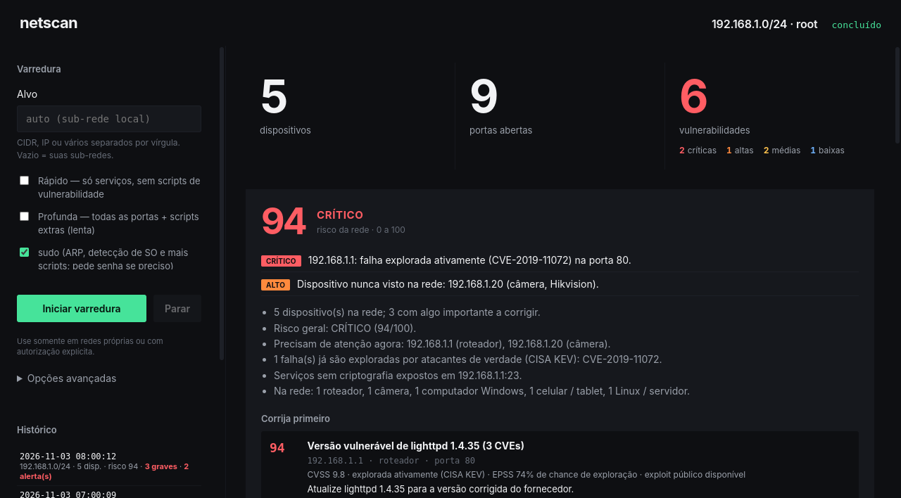
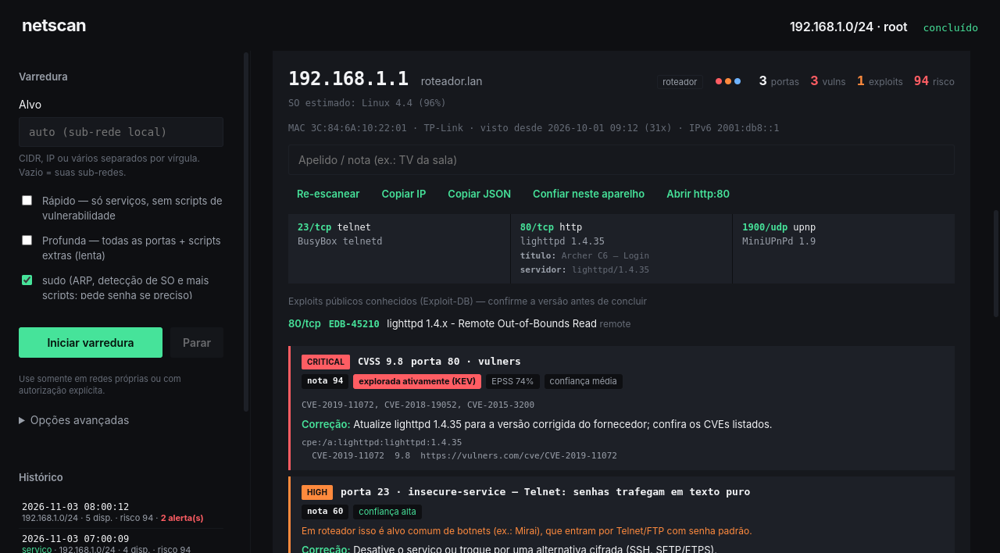
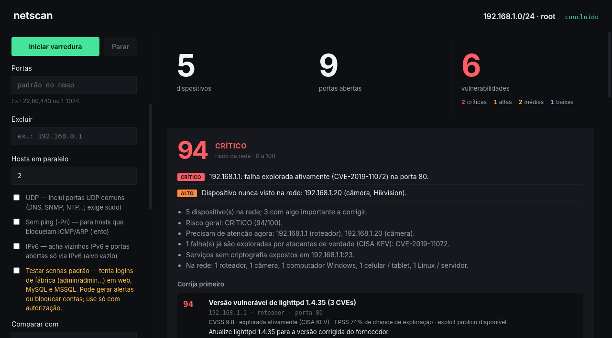
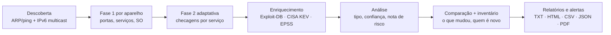

# netscan

**Varredura e análise automática de segurança da sua rede local.** Descobre todos os aparelhos
conectados, identifica o que cada um é, encontra vulnerabilidades e configurações perigosas,
prioriza o que corrigir primeiro e avisa quando algo muda — pela interface desktop, pela linha de
comando ou rodando sozinho em segundo plano.


> [!WARNING]
> Use **somente** em redes que você possui ou tem autorização explícita, por escrito, para testar.
> Varrer redes de terceiros sem permissão é ilegal na maioria dos países.



---

## Sumário

- [Destaques](#destaques)
- [Capturas de tela](#capturas-de-tela)
- [Como funciona](#como-funciona)
- [Instalação](#instalação)
- [Usando a interface](#usando-a-interface)
- [Usando a linha de comando](#usando-a-linha-de-comando)
- [Monitoramento em segundo plano](#monitoramento-em-segundo-plano)
- [Notificações (celular, Discord, Telegram)](#notificações)
- [Análise automática em detalhe](#análise-automática-em-detalhe)
- [O que é verificado](#o-que-é-verificado)
- [Relatórios gerados](#relatórios-gerados)
- [Privacidade e acesso à internet](#privacidade-e-acesso-à-internet)
- [Segurança do próprio app](#segurança-do-próprio-app)
- [Estrutura do projeto](#estrutura-do-projeto)
- [Desenvolvimento e testes](#desenvolvimento-e-testes)
- [Solução de problemas](#solução-de-problemas)
- [Licença](#licença)

---

## Destaques

| | |
|---|---|
| 🔎 **Descoberta completa** | ARP/ping em todas as sub-redes locais, vizinhos **IPv6** por multicast, nome, fabricante (MAC) e sistema operacional. |
| 🧠 **Análise automática** | Nota de risco **0–100** por achado, por aparelho e da rede; resumo em português e lista **"corrija primeiro"**. |
| 🌐 **Inteligência de ameaças** | Cruza CVEs com o catálogo **CISA KEV** (falhas exploradas de verdade) e o **EPSS** (probabilidade de exploração). |
| 💣 **Exploits públicos** | Busca no **Exploit-DB** local (`searchsploit`), offline, para cada serviço com versão identificada. |
| 🧩 **Varredura adaptativa** | Primeiro descobre os serviços; depois roda só as checagens que fazem sentido para cada um (web, SMB, SSH, RDP, bancos…). |
| 🏷️ **Tipo de aparelho** | Classifica roteador, câmera, impressora, NAS, TV, IoT, celular, PC Windows/Linux/Mac — com regras de risco por tipo. |
| 🛠️ **Como corrigir** | Cada achado vem com a correção recomendada, em linguagem direta. |
| 🔔 **Alertas** | Aparelho desconhecido, porta sensível nova, falha grave nova, certificado vencendo — por notificação, webhook ou Telegram. |
| ⏱️ **Roda sozinho** | Serviço do **systemd** que varre a cada X minutos, mesmo com o app fechado. |
| 📒 **Inventário** | Primeira/última vez que cada aparelho foi visto, histórico por aparelho e lista de aparelhos confiáveis. |
| 📄 **Relatórios** | TXT, HTML, CSV, JSON e **PDF**, com comparação entre varreduras. |

---

## Capturas de tela

**Análise da rede** — nota geral, alertas, resumo e o que corrigir primeiro (imagem acima).

**Detalhe do aparelho** — portas, título da página web, exploits públicos, achados com nota,
KEV/EPSS, nível de confiança e correção:



**Opções avançadas** — portas, exclusões, paralelismo, UDP, IPv6, senhas padrão, comparação e
monitoramento:



> As capturas usam dados de demonstração.

---

## Como funciona



1. **Descoberta** — `nmap -sn -PR` em todas as sub-redes privadas conectadas (ou no alvo informado).
   Com IPv6 ligado, envia ICMPv6 para `ff02::1` e associa cada endereço IPv6 ao aparelho IPv4
   de mesmo MAC.
2. **Fase 1** — para cada aparelho (em paralelo, se configurado): portas abertas, versão dos
   serviços (`-sV`) e sistema operacional (`-O`, com root).
3. **Fase 2 (adaptativa)** — só nas portas abertas, roda `vuln` + `vulners` e as checagens
   específicas de cada serviço encontrado. Nenhum script roda à toa, e cada um tem tempo máximo
   (`--script-timeout`), para que nada segure a varredura.
4. **Enriquecimento** — exploits públicos do Exploit-DB local; CVEs cruzados com CISA KEV e EPSS.
5. **Análise** — tipo do aparelho, confiança e nota de cada achado, risco do aparelho e da rede.
6. **Comparação e inventário** — o que mudou desde a varredura anterior e quais aparelhos nunca
   tinham sido vistos.
7. **Saída** — relatórios em `resultados_<data>/`, alertas e notificações.

---

## Instalação

### Pré-requisitos

| Necessário | Para quê |
|---|---|
| `nmap` | motor de varredura |
| `python3` (3.8+) | backend — só biblioteca padrão, sem `pip install` |
| `sudo` (recomendado) | ARP, detecção de SO, UDP e vários scripts precisam de root |

| Opcional | Para quê |
|---|---|
| `exploitdb` (`searchsploit`) | exploits públicos por serviço (já vem no Kali) |
| `chromium` ou `weasyprint` | PDF pela linha de comando (no app o PDF é gerado sem nada extra) |
| `notify-send` (libnotify) | notificação na área de trabalho pela linha de comando |
| `node` + `npm` | só para rodar a interface a partir do código-fonte |

No Debian/Ubuntu/Kali:

```bash
sudo apt install nmap python3 exploitdb
```

### Pacote `.deb` (recomendado)

```bash
git clone https://github.com/Hiagolim11/netscan.git
cd netscan
npm install
npm run dist                                   # gera dist/netscan-<versão>.deb e .AppImage
sudo apt install ./dist/netscan-1.2.0.deb      # o .deb já declara nmap e python3 como dependências
```

Depois é só abrir **netscan** pelo menu de aplicativos.

**Atualizar** para uma versão nova: puxe o código, gere de novo e reinstale.

```bash
git pull && npm install && npm run dist && sudo apt install ./dist/netscan-<nova-versão>.deb
```

### AppImage

```bash
chmod +x dist/netscan-1.2.0.AppImage
./dist/netscan-1.2.0.AppImage
```

### A partir do código-fonte

```bash
npm install          # se o binário do Electron não baixar: node node_modules/electron/install.js
npm start
```

A linha de comando não precisa de instalação: `python3 netscan.py --help`.

---

## Usando a interface

1. **Alvo** — deixe vazio para varrer todas as suas sub-redes, ou informe IP, CIDR, faixa ou
   vários separados por vírgula (`192.168.0.0/24, 10.0.0.5`). <kbd>Enter</kbd> inicia.
2. **Modo** — *Rápido* (só serviços), padrão (serviços + checagens) ou *Profunda* (todas as
   65.535 portas + scripts extras).
3. **sudo** — se o sistema pedir senha, uma janela a solicita (veja
   [Segurança do próprio app](#segurança-do-próprio-app)).
4. **Iniciar varredura** — os aparelhos aparecem conforme são encontrados, com a fase e o tempo
   restante de cada um e uma barra de progresso geral.

Ao terminar:

- O **card de análise** mostra a nota da rede, os **alertas**, o resumo e o **"corrija
  primeiro"**. Clicar num item leva direto ao aparelho.
- A lista fica **ordenada por risco**. Cada aparelho mostra o tipo, a nota de risco, quantas
  portas, vulnerabilidades e exploits tem, e se é **novo** ou **mudou** desde a última varredura.
- Clicar no aparelho (ou <kbd>Enter</kbd>) abre os detalhes: portas e serviços, título da página
  web, exploits, achados com **nota, KEV, EPSS, confiança e correção**.

**Ações por aparelho:** Re-escanear só ele · Copiar IP · Copiar JSON · Abrir http(s) nas portas
web · Abrir o exploit no Exploit-DB · **Confiar neste aparelho** (não gera mais alerta de
desconhecido) · Apelido/nota livre (ex.: "TV da sala").

**Barra de ferramentas:** filtro por IP, nome, tipo, serviço, CVE ou apelido (<kbd>/</kbd> foca o
filtro) · só com vulnerabilidades · expandir/recolher tudo.

**Painel lateral:**

- **Opções avançadas** — portas, exclusões, hosts em paralelo, UDP, sem ping (`-Pn`), IPv6,
  testar senhas padrão, comparar com qualquer varredura do histórico, repetir a cada N minutos
  (com o app aberto) e o **monitoramento em segundo plano** (com o app fechado).
- **Histórico** — todas as varreduras salvas, inclusive as feitas pelo serviço; clique para
  reabrir.
- **Relatório** — abrir o HTML, **exportar PDF** ou abrir a pasta.

---

## Usando a linha de comando

```bash
sudo python3 netscan.py                                   # todas as sub-redes locais
sudo python3 netscan.py -t 192.168.0.0/24                 # alvo explícito
sudo python3 netscan.py -t "192.168.0.0/24, 10.0.0.5"     # vários alvos
sudo python3 netscan.py --fast -w 8                       # rápido, 8 aparelhos em paralelo
sudo python3 netscan.py --deep --udp --ipv6               # o mais completo possível
sudo python3 netscan.py -p 22,80,443 -x 192.168.0.1       # portas escolhidas, excluindo o roteador
sudo python3 netscan.py --compare latest --pdf            # compara com a última e gera PDF
sudo python3 netscan.py --default-creds                   # também testa senhas de fábrica
```

### Todas as opções

| Opção | Descrição |
|---|---|
| `-t, --target` | Alvo(s): IP, CIDR, faixa, hostname ou IPv6; vários separados por vírgula/espaço. Padrão: todas as sub-redes locais. |
| `-o, --outdir` | Pasta de saída (padrão `./resultados_AAAA-MM-DD_HHMMSS`). |
| `--fast` | Só descoberta + serviços, sem checagens de vulnerabilidade. |
| `--deep` | Todas as portas (`-p-`), scripts `default` e tempo maior por script. |
| `-p, --ports` | Portas, na sintaxe do nmap: `22,80`, `1-1024`, `T:80,U:53`. |
| `-x, --exclude` | IPs/CIDRs a excluir. |
| `--udp` | Inclui portas UDP comuns (DNS, DHCP, NTP, SNMP, UPnP, mDNS…). Requer root. |
| `--no-ping` | Não testa se o aparelho está ativo (`-Pn`); para redes que bloqueiam ICMP/ARP. Limite de 1024 endereços. |
| `-w, --workers` | Aparelhos analisados em paralelo (1–16). |
| `--host-timeout` | Tempo máximo por aparelho, em segundos (padrão 1200). |
| `-6, --ipv6` | Descobre vizinhos IPv6 e procura portas abertas **só** via IPv6. |
| `--default-creds` | Testa senhas padrão de fábrica/vazias (web, MySQL, MSSQL). **Faz tentativas de login.** |
| `--offline` | Não baixa CISA KEV/EPSS; usa só o cache local. |
| `--compare ARQ\|latest` | Compara com um `relatorio.json` anterior, ou com o mais recente da pasta atual. |
| `--pdf` | Gera também `relatorio.pdf`. |
| `--notify` | Envia os alertas pelos canais configurados (veja [Notificações](#notificações)). |
| `--keep N` | Mantém só as N varreduras mais recentes na pasta atual. |
| `--install-service` | Instala o monitoramento periódico no systemd com as opções dadas (root). |
| `--uninstall-service` | Remove o monitoramento periódico (root). |
| `--every MIN` | Intervalo do serviço, em minutos (padrão 60, mínimo 5). |
| `--json-stream` | Emite um evento JSON por linha no stdout (usado pela interface). |

Códigos de saída: `0` sucesso · `1` erro de ambiente (nmap ausente, pasta, serviço) · `2` opção
inválida · `130` interrompido.

---

## Monitoramento em segundo plano

O netscan pode se instalar como um **timer do systemd**: a varredura roda periodicamente mesmo com
o app fechado, compara com a anterior, atualiza o inventário e envia os alertas.

**Pela interface:** *Opções avançadas → Monitoramento em segundo plano → a cada N min → Ativar*.
As opções de varredura escolhidas no painel são usadas pelo serviço.

**Pela linha de comando:**

```bash
sudo python3 netscan.py --install-service --every 60 -t 192.168.0.0/24 --fast -w 4
systemctl status netscan.timer          # próxima execução
journalctl -u netscan.service -e        # log das execuções
sudo python3 netscan.py --uninstall-service
```

O que é criado:

| Caminho | Conteúdo |
|---|---|
| `/etc/systemd/system/netscan.service` | execução única (`--compare latest --notify --keep 100` + suas opções) |
| `/etc/systemd/system/netscan.timer` | agenda: 5 min após o boot e depois a cada N min |
| `/var/lib/netscan/` | varreduras (`resultados_*`) e `inventario.json` do serviço |
| `/etc/netscan.env` | configuração das notificações (modo `600`, só root lê) |

Desinstalar remove o serviço e o timer, mas mantém os resultados e o `/etc/netscan.env`.

---

## Notificações

Os alertas podem ser enviados por qualquer combinação dos canais abaixo. Eles são configurados por
**variáveis de ambiente** — nunca na linha de comando, que fica visível no `ps`. No serviço, edite
`/etc/netscan.env`:

```ini
# Celular via ntfy (app gratuito para Android/iOS): assine o tópico no app
NETSCAN_WEBHOOK=https://ntfy.sh/meu-topico-secreto-123

# ou Discord / Slack (URL do webhook do canal)
#NETSCAN_WEBHOOK=https://discord.com/api/webhooks/...

# Telegram: token do @BotFather e o id do seu chat
NETSCAN_TELEGRAM_TOKEN=123456:ABC...
NETSCAN_TELEGRAM_CHAT=987654321
```

Na linha de comando, exporte as mesmas variáveis e use `--notify`. Numa sessão gráfica, sem root,
o alerta também aparece como notificação da área de trabalho. Na interface, os alertas sempre
aparecem como notificação do sistema.

**Quando um alerta é gerado:**

| Nível | Situação |
|---|---|
| Crítico | Falha **explorada ativamente** (CISA KEV) nova |
| Alto/crítico | Vulnerabilidade grave nova |
| Alto | **Aparelho nunca visto** na rede (e não marcado como confiável) |
| Médio | Aparelho abriu uma **porta sensível** (Telnet, SMB, RDP, VNC, bancos de dados, SNMP…) |
| Baixo | Certificado TLS **expirado ou vencendo** em menos de 30 dias |

Achados antigos não geram alerta de novo. Na primeira varredura, o inventário é criado sem acusar
ninguém de intruso.

---

## Análise automática em detalhe

### Nota de cada achado (0–100)

```
base   = CVSS do achado (ou 9,5 / 7,5 / 5 / 2,5 / 0,5 pela severidade)
nota   = base × 8
       + 15  se o CVE está no CISA KEV (explorado ativamente)
       + 10 × EPSS (probabilidade de exploração nos próximos 30 dias)
       +  5  se há exploit público para o serviço
nota   = nota × confiança (alta 1,0 · média 0,85 · baixa 0,6), limitada a 100
```

Assim, uma falha **CVSS 7,5 explorada ativamente** fica acima de uma **CVSS 9,8 que ninguém
explora** — que é o que importa na prática.

### Confiança

| Nível | Quando |
|---|---|
| Alta | Observado diretamente (porta aberta só no IPv6, FTP anônimo aceito, SMBv1 ativo…) ou script confirma `State: VULNERABLE` |
| Média | `LIKELY VULNERABLE`, ou CVE deduzido **só pela versão** (o fornecedor pode ter corrigido sem mudar a versão) |

### Risco do aparelho e da rede

- **Aparelho:** maior nota entre seus achados, + 2 por achado relevante adicional (até +10). Um
  serviço com exploit público conhecido garante no mínimo 30.
- **Rede:** o maior risco entre os aparelhos.
- **Níveis:** crítico ≥ 80 · alto ≥ 60 · médio ≥ 35 · baixo > 0 · ok = 0.

### Tipo de aparelho

Deduzido de portas, serviços, título da página web, fabricante do MAC, SO e nome: **roteador**
(inclui o gateway padrão) · **impressora** · **câmera** · **NAS** · **TV/mídia** · **IoT** ·
**computador Windows** · **Mac** · **Linux/servidor** · **celular/tablet** (inclusive por MAC
aleatório) · desconhecido.

Regra por tipo: em **câmera, IoT, roteador, impressora, NAS e TV** — aparelhos raramente
atualizados —, Telnet/FTP sobem para severidade **alta**, porque são a porta de entrada típica de
botnets como a Mirai.

---

## O que é verificado

### Checagens por serviço (fase 2)

| Serviço | Checagens |
|---|---|
| Todos | `vuln` (falhas conhecidas) · `vulners` (CVEs pela versão) |
| HTTP | título da página, servidor, métodos perigosos (PUT/DELETE) |
| TLS | protocolos e cifras fracas (nota C–F), certificado expirado/vencendo |
| SMB | SO, **SMBv1**, assinatura não obrigatória, acesso de convidado, compartilhamentos sem senha |
| SSH | algoritmos, métodos de login, **SSHv1** |
| FTP | login **anônimo**, sistema |
| RDP | **NLA** não exigida, informações NTLM |
| SNMP | community padrão (`public`) |
| VNC | acesso **sem senha** |
| Redis / MongoDB / Memcached | acesso **sem autenticação** |
| MySQL | informações do servidor |
| UPnP / RTSP / NTP | exposição e informações |
| Texto puro | Telnet, rlogin, rsh, rexec, FTP, TFTP |
| IPv6 | portas abertas no IPv6 que **não** estão abertas no IPv4 |
| Senhas padrão (opcional) | logins de fábrica em painéis web, senha vazia em MySQL/MSSQL |

No modo `--deep`, a fase 1 cobre todas as portas e a fase 2 inclui a categoria `default` do nmap.

### Exploits públicos

Para cada serviço com produto e versão, o `searchsploit` consulta o Exploit-DB **local**
(resultados de DoS ignorados). O Exploit-DB casa faixas de versão (ex.: "2.3 < 7.7"), por isso a
interface pede para confirmar a versão antes de concluir.

---

## Relatórios gerados

Cada varredura cria `resultados_AAAA-MM-DD_HHMMSS/` com:

| Arquivo | Conteúdo |
|---|---|
| `relatorio.txt` | Alertas, análise, "corrija primeiro", mudanças e detalhes por aparelho |
| `relatorio.html` | O mesmo, navegável, com links do Exploit-DB e tema claro na impressão |
| `relatorio.pdf` | Com `--pdf` ou pelo botão **Exportar PDF** do app |
| `relatorio.csv` | Uma linha por porta e por achado (risco, nota, confiança, KEV, EPSS, correção) — para planilha/ticket |
| `relatorio.json` | Tudo, estruturado (veja abaixo) |
| `discovery*.xml`, `host_*.xml` | Saída bruta do nmap |

Estrutura resumida do JSON:

```jsonc
{
  "target": "192.168.0.0/24",
  "timestamp": "2026-11-03 08:00:12",
  "totals":   { "critical": 2, "high": 1, "medium": 2, "low": 1, "info": 0 },
  "alerts":   [{ "level": "high", "ip": "192.168.0.20", "text": "Dispositivo nunca visto…" }],
  "analysis": { "risk": 94, "level": "critical", "summary": ["…"], "top": [/* corrija primeiro */] },
  "diff":     { "new_hosts": [], "gone_hosts": [], "changed": { "192.168.0.1": { "new_ports": ["23/tcp"] } } },
  "hosts": [{
    "ip": "192.168.0.1", "mac": "…", "vendor": "…", "type_label": "roteador", "risk": 94,
    "first_seen": "…", "seen_count": 31, "ipv6": ["…"], "os": { "name": "…" },
    "ports": [{ "port": "80", "proto": "tcp", "service": "http", "product": "lighttpd", "version": "1.4.35",
                "scripts": { "http-title": "…" }, "exploits": [{ "id": "45210", "title": "…" }] }],
    "vulns": [{ "port": "80", "id": "vulners", "severity": "critical", "cvss": 9.8, "cves": ["CVE-…"],
                "kev": ["CVE-…"], "epss": 0.74, "confidence": "medium", "score": 94,
                "reasons": ["…"], "fix": "Atualize …" }]
  }]
}
```

O inventário fica em `inventario.json`, na pasta de trabalho (no app instalado, a pasta pessoal;
no serviço, `/var/lib/netscan`).

---

## Privacidade e acesso à internet

A varredura acontece **só na sua rede**. Os únicos acessos externos são:

| Fonte | Para quê | Sem internet |
|---|---|---|
| CISA KEV (`cisa.gov`) | lista de CVEs explorados ativamente — baixada no máximo 1×/dia | usa o cache em `~/.cache/netscan/` |
| EPSS (`api.first.org`) | probabilidade de exploração — **só os números de CVE** são enviados, guardados por 7 dias | usa o cache |
| script `vulners` do nmap | CVEs pela versão do serviço — envia **nome e versão do software** | sem CVEs por versão |
| notificações | só se você configurar | — |

Nenhum IP, MAC ou nome da sua rede é enviado. `--offline` desliga KEV/EPSS. O Exploit-DB
(`searchsploit`) é sempre local.

---

## Segurança do próprio app

- **Senha do sudo:** digitada numa janela do app e entregue ao `sudo` pela entrada padrão (`-S`).
  **Nunca** é gravada em disco, registrada em log nem passada como argumento. No modo "repetir a
  cada N min", fica só na memória do processo principal enquanto o monitoramento está ativo e é
  descartada ao clicar em Parar. O serviço do systemd roda como root e não precisa de senha.
- **Interface isolada:** `contextIsolation`, sem `nodeIntegration`, Content-Security-Policy
  restritiva e API mínima exposta pelo `preload`.
- **Entradas validadas:** alvos, portas e exclusões passam por validação e chegam ao nmap como
  argumentos, nunca por shell. URLs abertas no navegador são montadas no processo principal a
  partir de IP/porta/ID numérico validados. Caminhos de relatório só são aceitos dentro das pastas
  de resultados.
- **Encerramento limpo:** parar a varredura encerra todos os `nmap` em andamento e impede que os
  aparelhos na fila comecem.
- **Senhas padrão desligadas por padrão:** o teste de logins de fábrica só roda se você marcar a
  opção, porque pode gerar alertas em sistemas de monitoramento ou bloquear contas.

---

## Estrutura do projeto

```
netscan/
├── netscan.py          # backend/CLI: descoberta, fases de varredura, achados, relatórios
├── analysis.py         # KEV/EPSS, confiança, nota de risco, tipo de aparelho, resumo
├── automation.py       # inventário, alertas, notificações, serviço do systemd
├── main.js             # processo principal do Electron (spawn, sudo, IPC, PDF)
├── preload.js          # ponte segura entre a interface e o processo principal
├── renderer/           # interface: index.html, renderer.js, styles.css
├── test_netscan.py     # testes do backend
├── test_analysis.py    # testes da análise
├── test_automation.py  # testes da automação
├── docs/               # capturas de tela
└── build/icon.png      # ícone do app
```

O backend usa **só a biblioteca padrão do Python**. A interface conversa com ele por um fluxo de
eventos JSON (`--json-stream`): `start`, `phase`, `discovery`, `host_start`, `host_progress`,
`host_done`, `done`, `service`, `aborted`, `fatal`.

---

## Desenvolvimento e testes

```bash
python3 -m unittest test_netscan test_analysis test_automation    # 34 testes, sem rede e sem root
npm start                                                         # interface em modo desenvolvimento
npm run dist                                                      # gera .deb e .AppImage em dist/
```

Os testes cobrem a leitura do XML do nmap, a seleção adaptativa de checagens, os achados de
configuração, a nota de risco e o KEV/EPSS (com cache falso), o tipo de aparelho, o inventário, as
regras de alerta, as unidades do systemd e o envio de webhook (servidor local).

---

## Solução de problemas

<details>
<summary><b>Nenhum dispositivo encontrado</b></summary>

- Marque **sudo**: sem root não há ARP scan, e muitos aparelhos não respondem a ping.
- Confira o alvo: ele precisa ser a sua sub-rede (veja com `ip -4 addr`).
- Se a rede bloqueia ICMP/ARP, use **Sem ping** (`--no-ping`) num alvo pequeno.
</details>

<details>
<summary><b>A varredura está lenta</b></summary>

- Aumente **Hosts em paralelo** (`-w`).
- Use **Rápido** (`--fast`) para um inventário em poucos segundos por aparelho.
- O modo padrão roda as checagens de vulnerabilidade só nas portas abertas, com no máximo 2 min por
  script (5 min no profundo). `--deep` e `--udp` são bem mais lentos por natureza.
</details>

<details>
<summary><b>"Catálogo CISA KEV indisponível" / sem EPSS</b></summary>

Sem internet, o netscan usa o último cache (`~/.cache/netscan/`). A varredura funciona
normalmente; só a priorização por KEV/EPSS fica desatualizada ou ausente.
</details>

<details>
<summary><b>Os exploits não aparecem</b></summary>

Instale o Exploit-DB (`sudo apt install exploitdb`). A busca só roda para serviços cuja **versão**
o nmap conseguiu identificar.
</details>

<details>
<summary><b>O monitoramento em segundo plano não envia alertas</b></summary>

- Confira `/etc/netscan.env` (sem `#` na frente das linhas usadas).
- Veja o log: `journalctl -u netscan.service -e` — a linha "Alertas enviados por: …" mostra os
  canais usados.
- Lembre que só **mudanças** geram alerta; na primeira execução, o inventário é só criado.
</details>

<details>
<summary><b>O binário do Electron não baixou no <code>npm install</code></b></summary>

Rode `node node_modules/electron/install.js`.
</details>

---

## Licença

[MIT](LICENSE) © Hiagolim11
